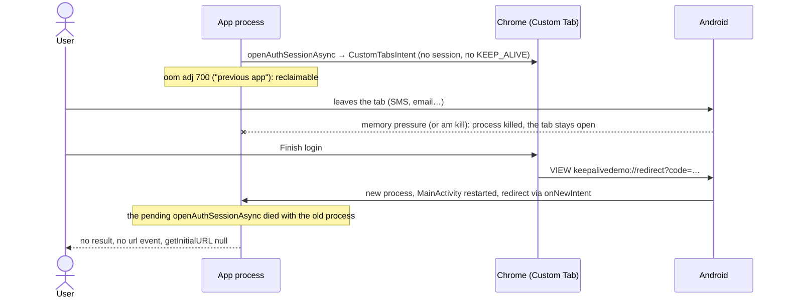
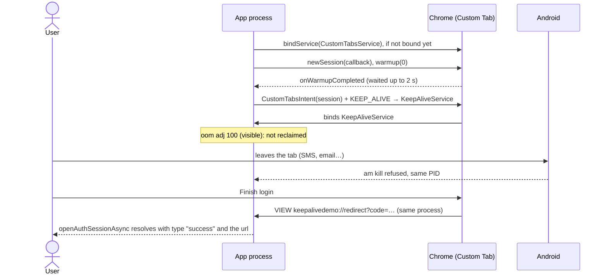

# expo-web-browser: app killed while the auth Custom Tab is open (Android)

Minimal reproduction for `WebBrowser.openAuthSessionAsync` on Android.

While the Custom Tab is in front, the app process is only a "previous app" (`oom adj 700`), so Android can reclaim it. In real use this happens when the user leaves the tab mid-login, e.g. to read an SMS or an email code. When they finish the login, the redirect cold-starts the app and the result is lost: `openAuthSessionAsync` never resolves, `Linking.getInitialURL()` returns `null`, and no `url` event fires.

Chrome can keep the opener alive for the lifetime of the tab, but only when asked to: `expo-web-browser` opens the tab without a `CustomTabsSession` and without the `android.support.customtabs.extra.KEEP_ALIVE` extra, so it never is.

## Versions

|                  |                                  |
| ---------------- | -------------------------------- |
| expo             | 58.0.25                          |
| expo-web-browser | 58.0.8                           |
| react-native     | 0.88.1                           |
| Device           | Pixel 7 emulator, Android API 37 |
| Browser          | Chrome 145.0.7632.218            |

## Branches

- `main`: stock `create-expo-app` (blank-typescript) + `expo-web-browser`. Reproduces the bug.
- `keep-alive`: same app with a `patch-package` patch on `expo-web-browser` that opens the tab with a session and `KEEP_ALIVE`. Shows the fix.

## The app

One button calls `WebBrowser.openAuthSessionAsync(AUTH_URL, 'keepalivedemo://redirect')`. The screen shows:

- `JS started at`: changes when the process restarts (cold start);
- the `openAuthSessionAsync` result;
- `Linking.getInitialURL()`;
- the last `Linking` `url` event.

`auth-page/index.html` stands in for the auth provider: a page with a "Finish login" link to the redirect URL. The link needs a user tap, which is also what lets the tester kill the app in between.

## Reproduce

Requirements: an Android emulator or device with Chrome as the default browser, JDK 17, Python 3.

```sh
npm install
npm run serve-auth-page               # serves auth-page/ on :8000, leave it running
adb reverse tcp:8000 tcp:8000         # the app opens http://localhost:8000
npm run android:release               # release build: the dev client handles links itself and hides the bug
```

Then:

1. Tap **Start auth session**. The Custom Tab opens on the fake auth page.
2. With the tab in front, check the app's priority:
   ```sh
   adb shell dumpsys activity processes com.example.keepalivedemo | grep "oom adj"
   # oom adj: ... cur=700 set=700
   ```
3. Kill it the way Android would under memory pressure:
   ```sh
   adb shell am kill com.example.keepalivedemo
   adb shell pidof com.example.keepalivedemo   # nothing: the process is gone, the tab is still open
   ```
4. Tap **Finish login** in the tab.

## Results

### `main` (stock)

| Step              | Observed                                                                                                    |
| ----------------- | ----------------------------------------------------------------------------------------------------------- |
| No kill (control) | `{"type":"success","url":"keepalivedemo://redirect?code=demo-code&state=demo-state"}`, `url` event received |
| Tab in front      | `oom adj` 700                                                                                               |
| `am kill`         | process killed (`am_kill … 700, kill background` in `logcat -b events`)                                     |
| Finish login      | cold start (`JS started at` changes); result `none`, `getInitialURL` `none`, no `url` event                 |

`logcat -b events` shows how the redirect reaches the new process: `wm_new_intent` on the surviving task, then `am_proc_start`, then `wm_restart_activity` for `MainActivity`. The redirect arrives through `onNewIntent`, not `onCreate`, so the activity's own intent is still the launcher intent.

### `keep-alive` (patched)

Measured with Chrome started cold (`am force-stop com.android.chrome` before launching the app, so no earlier `warmup()` from this app) and no JS `warmUpAsync()`; 3 runs, plus one warm second launch:

| Step         | Observed                                                       |
| ------------ | -------------------------------------------------------------- |
| Tab in front | `oom adj` 100 (`onWarmupCompleted` received after ~0.7 s cold, ~0.1 s warm) |
| `am kill`    | refused: same PID before and after                             |
| Finish login | same process; `{"type":"success", …}`, `url` event received    |

To run it: `git switch keep-alive && npm install` (applies `patches/expo-web-browser+58.0.8.patch` and builds `expo-web-browser` from source through `expo.autolinking.android.buildFromSource`), then rebuild the release. Back on `main`, run `rm -rf node_modules/expo-web-browser && npm install` to restore the unpatched module.

## How it fails, and the fix

### Stock `expo-web-browser`



### Patched (`keep-alive` branch)



## What the patch does

All in `expo-web-browser/android`:

- `KeepAliveService`: an empty exported `Service` whose `onBind` returns a `Binder`. Chrome binds to it for as long as the tab is open, which raises the app to a visible priority.
- `CustomTabsConnectionHelper.awaitSessionForKeepAlive(packageName)`: binds to the browser's `CustomTabsService` if needed (waiting up to 1 s), creates a `CustomTabsSession` with a callback, calls `warmup(0)`, and, when the browser is Chrome (stable, beta, dev or canary), waits up to 2 s for its `onWarmupCompleted` extra callback before returning the session. Other browsers are not waited for: Firefox, for one, never sends that callback, so waiting would add 2 s before every tab for no keep-alive. The patch listens to the `extraCallback` form because `expo-web-browser` compiles against `androidx.browser` 1.6.0, which has no `CustomTabsCallback.onWarmupCompleted`; Chromium marks the extra callback for eventual removal, so check the tab still opens without a ~2 s delay on newer Chrome versions.
- `openBrowserAsync`: builds the tab with `CustomTabsIntent.Builder(session)` and puts `KEEP_ALIVE` = an `Intent` targeting `KeepAliveService`. Without a session (no Custom Tabs browser, or timeout), the tab opens exactly as before.

**Why the patch waits for `onWarmupCompleted`.** With the session and the extra but no completed `warmup()`, Chrome 145 did not bind `KeepAliveService` (`oom adj` stayed at 700). Calling `warmup(0)` right before the launch was not enough either: Chromium cancels pending warm-up tasks when it handles the tab intent (`CustomTabsConnection.onHandledIntent`), so the warm-up never finished. Waiting for `onWarmupCompleted`, which Chromium sends to every session of the app once warm-up is done (even when Chrome was already warm), fixed it in every run. Calling `WebBrowser.warmUpAsync()` from JS well before opening the tab (for example on mount) also works, for the same reason.

Neither the [Android](https://developer.android.com/develop/ui/views/layout/webapps/overview-of-android-custom-tabs) nor the [Chrome](https://developer.chrome.com/docs/android/custom-tabs/guide-warmup-prefetch) documentation ties the keep-alive to `warmup()`, and Chromium's `ClientManager.keepAliveForSession` does not check it, so why a completed warm-up is needed is still unknown: this is an observation on Chrome 145, not a documented requirement.

## References

- Chromium `ClientManager.keepAliveForSession`: "Keeps the client app alive, when possible".
